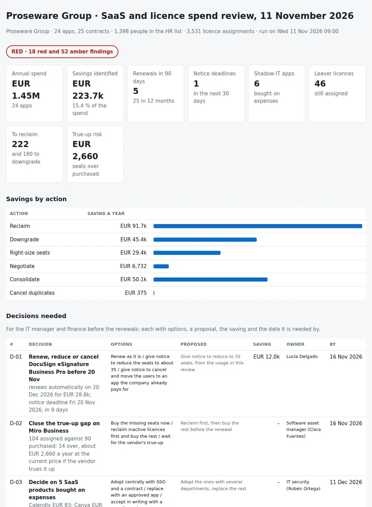

# SaaS and Licence Spend Review

The question for the IT manager and finance every month, and before every renewal: what are we paying for in software licences and SaaS, what is actually used, what renews soon, and how much can we save before each renewal? From the licence and SaaS register (Flexera, Apptio or the contract sheet), the licence assignments with each user's last activity, the HR or Entra ID user list and the card expenses and AP invoices, it puts together:

- **Usage:** licences unused for 60 days or never used since they were assigned, licences still assigned to leavers, licences of people on long leave or of accounts HR does not know, and premium tiers (Microsoft 365 E5, for example) for people who do not use the premium features.
- **Seats:** shelfware, seats bought and not assigned, and over-assignment, more assigned than bought, which is a true-up waiting to happen.
- **Renewals:** auto-renewing contracts whose notice deadline is close or already passed, uplifts above the agreed cap, contracts with no owner, and the renewal calendar for the next 12 months.
- **Portfolio:** several apps paid for the same capability (three video-meeting tools, two file-sharing tools next to OneDrive) and apps without SSO that hold confidential data.
- **Shadow IT:** SaaS bought on expenses that is not in the register, and card purchases of an app the company already has under a central contract.
- **Cost allocation:** showback per department and cost centre, contracts with no or an unknown cost centre, and spend against budget per category.

Every saving is tied to an action, **reclaim, downgrade, right-size, negotiate, consolidate or cancel**, with the users behind it, an owner and a due date, and counted once per app: **what we pay for, what is used, what renews next, and what to do before the notice deadline.**

Python 3.10+, standard library only. It runs with fictional demo data out of the box. A read-only Python exporter for Microsoft Graph writes the Microsoft 365 licences, the last sign-in of each user and the seats bought per SKU.

The review sits between two earlier repos in the series: [23-it-vendor-contract-tracker](https://github.com/inigogonzalezgarcia/23-it-vendor-contract-tracker) keeps every IT contract, its notice deadline and its SLA, and [43-azure-cost-rightsizing](https://github.com/inigogonzalezgarcia/43-azure-cost-rightsizing) does for the Azure bill what this one does for licences and SaaS.



## Why

Software and SaaS spend grows one reasonable request at a time, and the licences are almost never taken back. In a typical month in a company of 1,400 people:

- 180 people have Microsoft 365 E5 and use nothing that E3 does not already give them;
- 46 licences are still assigned to people who left months ago, which is a cost and an open door;
- a third of the Adobe Creative Cloud licences have not been opened for three months;
- the company pays for Zoom and Webex while everyone already has Teams, and for Dropbox and Box next to OneDrive;
- the DocuSign contract renews automatically in under six weeks with a third of its seats unassigned, and the notice deadline is in 9;
- Salesforce comes back with a 9 % uplift when the company's cap is 5 %;
- Miro has more people than seats, and the true-up will arrive at list price;
- nobody owns the Smartsheet contract, and it holds confidential data without single sign-on;
- people pay for Canva, Notion, ChatGPT Plus, Calendly and Grammarly on their cards, and three people buy Acrobat that way too.

The data to see all of this exists: the register, the admin consoles, Entra ID, HR and the expense tool. The review reads them together, applies thresholds agreed with finance, and turns the result into savings per action, decisions with options and a calendar of notice deadlines. The rules are in `settings.json` and `licencereview/checks.py`.

## What it checks

| Area | Code | Finding | Severity |
|---|---|---|---|
| Usage | USE-LEAVER | Licences still assigned to people who have left | RED |
| Usage | USE-INACTIVE, USE-NEVER | No activity for more than 60 days (RED above 20 % of the app); never used, assigned more than 30 days ago | AMBER / RED, AMBER |
| Usage | USE-DOWNGRADE | Active users of a premium tier who do not use the premium features (saving = price difference) | AMBER |
| Usage | USE-LEAVE, USE-UNKNOWN | Licences of people on long leave; held by accounts that are not in the HR list | AMBER |
| Seats | SEAT-SHELF | Seats bought and not assigned above 5 / 15 % | AMBER / RED |
| Seats | SEAT-OVER | More assigned than bought: true-up risk | RED |
| Renewals | REN-NOTICE | Notice deadline within 45 / 14 days or passed on an auto-renewing contract; a contract that ends without auto-renewal | AMBER / RED |
| Renewals | REN-UPLIFT, REN-OWNER | Uplift above the 5 % cap at a renewal in the next 12 months; contract with no owner | AMBER |
| Portfolio | PRT-OVERLAP | Apps for the same capability, or a capability the suite already covers: consolidation candidates | AMBER |
| Portfolio | PRT-SSO | Confidential data in an app without SSO | AMBER |
| Shadow IT | SHD-UNMANAGED, SHD-DUPLICATE | SaaS on expenses not in the register; card purchases of a vendor under a central contract | AMBER |
| Allocation | ALC-NOCC, ALC-CC, ALC-BUDGET | No cost centre; unknown cost centre; spend over budget per category or in total (RED beyond 10 %) | AMBER / RED |

The savings are annual, at the current unit price. They are applied per app in the order reclaim, downgrade, right-size, negotiate, cancel duplicates, then consolidate, and capped at what the app costs, so the same euro is never counted twice: consolidating Zoom counts only what is left of its cost after its inactive licences and unassigned seats. Last activity is what each tool exports; for Microsoft 365 it is the last successful sign-in to Entra ID, which shows that the account is in use, not that a particular app is, so the reclaim list goes to the app owner before anything is removed.

## Outputs

| File | What |
|---|---|
| `report.html` | Tiles (annual spend, savings in euros and %, renewals in 90 days, notice deadlines in 30 days, shadow-IT apps, leaver licences, true-up risk), savings by action, the decisions, utilisation per app with bars of active, idle, inactive, leaver and unassigned seats, the renewal calendar, showback per department, shadow IT and every finding |
| `review-pack.md` | One page for the IT manager and finance: headlines, decisions with options, proposal, saving, owner and date, the renewals to negotiate with the notice deadline, savings by action, the actions, scope and evidence, notes |
| `app-utilisation.csv` | One row per app and SKU: seats, assigned, active, idle, inactive, never used, leavers, on leave, unknown, downgrade candidates, unassigned, utilisation, cost and saving |
| `reclaim-list.csv` | One row per user and licence to reclaim or downgrade: user, department, app, SKU, reason, last active, saving |
| `renewal-calendar.csv` | The next 12 months of renewals: notice deadline, days left, auto-renew, uplift, cost after the uplift, utilisation, saving identified, owner |
| `showback.csv` | Cost per department and cost centre, people, licences, share and cost per person; unassigned seats and central contracts on their own rows |
| `findings.csv` | Every finding with severity, area, apps, detail, action, lever, saving, cost exposure, owner and due date |
| `actions.csv` | Every finding as an action with a reference, owner, due date and done column |

## Try it

```bash
git clone https://github.com/inigogonzalezgarcia/50-saas-licence-spend-review.git
cd 50-saas-licence-spend-review
python -m licencereview demo
```

Open `output/report.html` and `output/review-pack.md`.

### The demo data

The demo is a made-up distribution company, Proseware Group, with 1,370 employees in Spain, Portugal, France and Italy (plus 28 people who have left), paying in euros for 24 apps on 25 contracts. The review runs on Wednesday 11 November 2026:

- 25 contracts, 3,531 licence assignments, 1,398 people in the HR list and 349 expense lines over twelve months.

Everything is fictional: people, contracts, prices, dates and expenses. The product names are real; their prices and terms here are invented. The problems are placed on purpose among apps that are used as they should be:

- **Downgrade:** 180 Microsoft 365 E5 users who do not use the E5 features, EUR 45.4k a year as E3.
- **Leavers:** 46 licences still assigned to 28 people who have left, 28 of them Microsoft 365.
- **Inactive:** 18 of the 60 Adobe Creative Cloud licences (30 %) unused for more than 90 days; 23 % of LinkedIn Learning.
- **Overlap:** Zoom and Webex next to Teams, Dropbox and Box next to OneDrive.
- **Notice:** DocuSign renews automatically on 20 December with a 30-day notice period: the deadline is in 9 days, and 19 of its 60 seats are unassigned. LinkedIn Learning's deadline has already passed.
- **Uplift:** Salesforce at 9 % against the 5 % cap.
- **True-up:** Miro with 104 people on 90 seats.
- **Owner and SSO:** Smartsheet with no owner, holding confidential data without SSO.
- **Shadow IT:** Canva, Notion, ChatGPT Plus, Calendly and Grammarly on cards, and Adobe Acrobat bought on cards while it is under a central contract.
- **Cost allocation:** KnowBe4 with no cost centre, TeamViewer on a cost centre that does not exist, CRM spend 5 % over its budget.

The result: **RED**; annual spend EUR 1.45M; savings identified **EUR 223.7k a year (15.4 %)**: reclaim EUR 91.7k, consolidate EUR 50.1k, downgrade EUR 45.4k, right-size EUR 29.4k, negotiate EUR 6.7k and cancel duplicates EUR 375; 222 licences to reclaim and 180 to downgrade; 5 renewals in the next 90 days, one notice deadline in the next 30; 6 shadow-IT apps; 18 red and 52 amber findings; 7 decisions.

## Use it with your own data

1. Export the Microsoft 365 licences (read-only):
   ```bash
   export GRAPH_CLIENT_SECRET=...        # or leave it unset and type it when asked
   python scripts/export_m365_licences.py --tenant contoso.onmicrosoft.com --client-id <application id> --out data
   ```
   - It reads `GET /subscribedSkus` (the seats bought, `prepaidUnits`, and assigned, `consumedUnits`, per SKU) and `GET /users` with `$select=userPrincipalName,displayName,accountEnabled,department,usageLocation,employeeOrgData,assignedLicenses,signInActivity`, following `@odata.nextLink`.
   - An app registration with the application permissions LicenseAssignment.Read.All, User.Read.All and AuditLog.Read.All, admin consent, and a client secret (client credentials). `signInActivity` needs a Microsoft Entra ID P1 or P2 licence in the tenant.
   - It writes `assignments.csv` (SKU part number, user, last successful sign-in) and `contracts-m365.csv`, one row per SKU with the seats bought, to complete with prices, renewal and notice and copy into `contracts.csv`; `--users` also writes `users.csv` from Entra ID.
   - Only GET requests; the secret stays in memory and is never written to disk.
2. Export the other assignments from each app's admin console (most SaaS admin consoles export users with a last-login date), `contracts.csv` from the SAM tool or the contract sheet, `users.csv` from HR (it knows who has left better than Entra ID does) and `expenses.csv` from the expense tool and the AP lines. Adjust `data/settings.json`: review date, thresholds, budgets, cost centres, the capabilities your suite covers, the SaaS keywords for expenses and the owners ([docs/data-format.md](docs/data-format.md) has every column and setting).
3. Build the outputs:
   ```bash
   python -m licencereview review data/
   ```

[docs/renewal-runbook.md](docs/renewal-runbook.md) has the monthly reclaim cycle, the steps 120, 90 and 60 days before a renewal, how to negotiate with usage data (true-up and true-down, uplift caps, tiers, co-terming, consolidation), how to handle shadow IT without blocking people, showback, and who approves what.

The exports contain names, departments, prices and contracts. Keep them inside your organisation:

- real files at the top level (`contracts*.csv`, `assignments*.csv`, `users*.csv`, `expenses*.csv`, `settings.json`, `data/`, `downloads/`) and the `output/` folder are excluded from Git by `.gitignore`;
- only the fictional files in `sample_data/` are committed.

## Tests

```bash
pip install -r requirements-dev.txt
python -m pytest -q
```

GitHub Actions runs them on Python 3.10 and 3.12 on every push, then rebuilds the fictional sample data and the report screenshot from the simulator.

15 tests: loading register column names, monthly prices, currencies, uplifts and licence models; assignments, HR status words and matching by app or SKU part number; leavers, inactive, never-used, long-leave and unknown accounts; downgrades only for active users without premium use; shelfware and over-assignment; notice deadlines, auto-renew and roll-forward; uplifts and contracts without owner; overlap with the suite and between apps, counted once; SSO and shadow IT from expenses, with AP invoices left out; showback that adds up, cost centres and budgets; the savings cap and the decisions; missing files; the demo end to end (deterministic, all eight outputs, every planted finding); and the Graph exporter against mocked responses.

## Next steps

- Run it on the first working day of every month, and again 120 days before each large renewal.
- Read the other apps' assignments straight from their admin APIs (Adobe, Zoom, Salesforce, Atlassian) instead of console exports.
- Use the Microsoft 365 usage reports for the activity per workload (Teams, Exchange, OneDrive), which says more than the last sign-in for the E5 to E3 question.
- Keep each month's utilisation to show the trend per app at the renewal meeting.
- Feed the savings that were actually realised back into the IT budget tracking.

## Background

Built from my work on software and SaaS costs:

- software asset management and licence and SaaS cost control, with Apptio and Flexera, TBM and FOCUS; showback and chargeback and unit cost metrics; applying the FinOps Framework;
- Microsoft 365 as Global Administrator, managing Office 365 licences with a central service desk, and Adobe licences;
- Entra ID: Conditional Access, PIM and SAML single sign-on for enterprise applications; Microsoft Graph;
- the relationship with vendors such as Microsoft, Dell and Atlassian, negotiating vendor contracts, preparing and tracking the IT budget, and business cases with ROI;
- Python and PowerShell automation.

Written from scratch with fictional data; no employer data, systems or exports are used.

## Customisation and contact

Want this adapted to your environment? For example:

- your SAM tool's export or API as the source of the register;
- the admin APIs of your main SaaS apps for the assignments and last activity;
- your thresholds, budgets, cost centres and approval rules;
- the pack in the format of your monthly review with finance.

Get in touch:

- Website (contact form): [inigogonzalezgarcia.github.io](https://inigogonzalezgarcia.github.io/about.html#contacto)
- LinkedIn: [linkedin.com/in/igonzalez93](https://www.linkedin.com/in/igonzalez93)

## License

MIT
